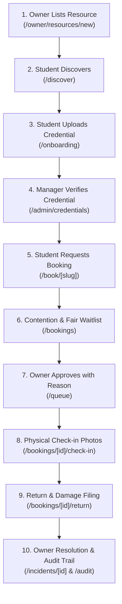
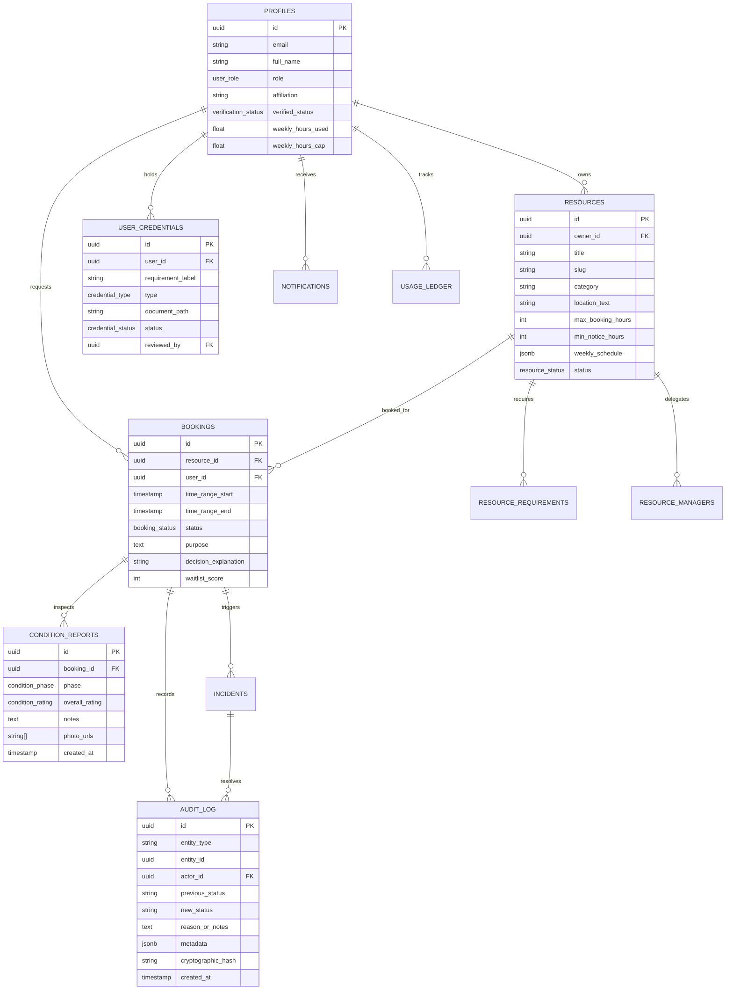

# Commons — Trusted Campus Resource Sharing

> **Collegiate Resource Sharing Platform**  
> Engineered for the Eastbrook Institute of Technology community.  
> *Calm, editorial, and high-trust custody for specialized labs, studio suites, media gear, fabrication machines, and precision instruments.*

---

## 1. Executive Summary & North Star

Campuses possess millions of dollars in specialized equipment—confocal microscopes, 4-axis CNC mills, audio isolation booths, and cinematic camera rigs—that sit idle up to 70% of the academic calendar. Meanwhile, engineering and design students face opaque gatekeeping, missing prerequisites discovered at the door, and endless email chains.

**Commons** solves campus equipment sharing through a high-trust, editorial system governed by three foundational pillars:
1. **Zero-Slop Editorial Design**: Archival collegiate aesthetics (Instrument Serif, Geist, warm bone `#F3EEE4`, terracotta `#B8522E`, and sage `#8A9A7B`), restrained motion, and generous whitespace.
2. **Postgres RPC & Immutable Audit Trails**: Zero direct client updates to booking or condition status. Every lifecycle mutation flows through strict stored procedures that atomically sign and log tamper-evident audit records.
3. **Judge Self-Serve Guarantee**: A hackathon judge or new student can complete the full 10-step lifecycle unassisted, switching between personas with a single click.

---

## 2. Judge Self-Serve Guarantee (10-Step North Star Journey)

A persistent, floating **"Guided Demo" widget** is mounted across the application (bottom-right on desktop, bottom tab on mobile). Clicking any step switches your active persona instantly and deep-links directly to the relevant view:



| Step | Persona | Action | Where to Test | Key Architectural Mechanism |
|---|---|---|---|---|
| **1. Listing** | **Owner** (`Dr. Kavitha Rao`) | Publishes precision tool with weekly availability rules & safety prerequisites | `/owner/resources/new` | 8-step wizard with local autosave drafts & weekly grid editor |
| **2. Discovery** | **Student** (`Aanya Patel`) | Queries resource with natural language; inspects live eligibility chips | `/discover` | Gemini-powered semantic filter extraction + PostgreSQL tsvector full-text search |
| **3. Qualification** | **Student** (`Aanya Patel`) | Sees "Needs: Laser Safety Certification" & uploads PDF proof to secure vault | `/onboarding` | Private storage bucket (`credentials`) with zero-leak RLS |
| **4. Verification** | **Manager** (`Imran Syed`) | Evaluates uploaded certificate; reviews AI name mismatch hints & 15m signed URL | `/admin/credentials` | Cryptographically signed URL with 15-minute expiration + advisory AI pre-check |
| **5. Reservation** | **Student** (`Aanya Patel`) | Picks slot, enters purpose declaration, reviews dry-run fair-use cap pass/fail | `/book/microscope-bio-401` | 4-step booking sheet; prevents over-allocation before submission |
| **6. Waitlist** | **Student** (`Aanya Patel`) | Contention computes transparent priority score & displays rank breakdown | `/bookings` (Waitlist tab) | Algorithmic scoring (+seniority, +clean standing, −recent hours, −no-shows) |
| **7. Approval** | **Owner** (`Dr. Kavitha Rao`) | Compares competing requests side-by-side; issues human-reasoned approval | `/queue` | Mandatory written justification logged to audit trail; zero direct SQL mutations |
| **8. Check-In** | **Student** (`Aanya Patel`) | Arrives on site; checks rules, uploads timestamped condition photos, starts timer | `/bookings/bk-demo-01/check-in` | Client-side HTML5 canvas photo compression + offline localStorage backup |
| **9. Return** | **Student** (`Aanya Patel`) | Compares before/after condition side-by-side; flags scratch & files incident | `/bookings/bk-demo-01/return` | Visual before/after inspection card + atomic return RPC transaction |
| **10. Resolution** | **Admin / Owner** | Resolves incident with written note & penalty action; both inspect audit ledger | `/incidents/[id]` & `/admin/audit` | SHA-256 tamper-evident vertical timeline with printable PDF certificate & CSV export |

---

## 3. Demo Accounts & One-Click Persona Switcher

You do not need to memorize passwords. Click the **Role Switcher Pill** in the top navigation or use the login screen chips:

| Role | Demo Identity | Email | Affiliation / Access Level | Default Responsibilities |
|---|---|---|---|---|
| **Student** | **Aanya Patel** | `aanya.patel@eastbrook.edu` | B.Tech Mechanical Engineering, Year 3 | Discovers resources, verifies qualifications, requests bookings, uploads check-in/return condition photos. |
| **Owner** | **Dr. Kavitha Rao** | `kavitha.rao@eastbrook.edu` | Chair of Bio-Optics & Digital Fabrication | Owns laboratory benches & equipment; creates listings, sets availability, issues approvals with required human justifications. |
| **Manager** | **Imran Syed** | `imran.syed@eastbrook.edu` | Department Facility Coordinator | Reviews student credentials, inspects physical condition on return, oversees day-to-day custody. |
| **Admin** | **Office of the Provost** | `provost.admin@eastbrook.edu` | Campus Institutional Oversight | Campus-wide governance, dispute appeals, utilization metrics, fair-use anomaly monitor, and immutable audit ledger. |

---

## 4. Technical Architecture

### Tech Stack
- **Framework**: Next.js 15 (App Router, React 19, Server Components by default)
- **Language**: TypeScript (`strict: true`, zero `any`, strict null checks)
- **Styling**: Tailwind CSS with custom collegiate design tokens (8pt spacing grid, hairline borders)
- **Database & Auth**: Supabase PostgreSQL with 14 relational tables, Row Level Security (RLS) on every table, and Storage Buckets
- **State Mutations**: 100% Postgres RPC Functions (`SECURITY DEFINER`); zero direct client `UPDATE`s on critical tables
- **AI Integration**: Google Gemini 1.5 Flash via server-side API routes (advisory-only, rate-limited, deterministic fallbacks)
- **Landing Experience**: Lenis smooth scroll + GSAP ScrollTrigger (dynamic-imported on landing only; respects `prefers-reduced-motion`)
- **Icons & Polish**: Lucide React (no emojis as UI icons), Sonner toasts, Framer Motion

### Database Schema (Mermaid ERD)



---

## 5. How We Handle Fairness, Privacy & Human Oversight

### 1. Algorithmic Fair-Use & Waitlists (Anti-Hoarding)
Campus equipment is frequently monopolized by senior labs or fast-clicking students. Commons replaces first-come-first-served with a transparent, rule-based equity engine:
- **Weekly Hour Caps**: Students have an institutional budget (e.g. 8 hours/week). Requesting additional hours requires a department override.
- **Fair Priority Formula**: When two students request the same slot:
  $$\text{Score} = \text{Seniority} (+20) + \text{Clean Standing} (+45) + \text{Need} (+15) - (\text{Hours Used} \times 2) - (\text{No-Shows} \times 30)$$
- **Transparent Position**: Students see the exact breakdown: *"Why you're #2: 3h used this month (+4), 12 days since last booking (+3), 1 no-show (−1)"* alongside recommended conflict-free open slots.

### 2. Privacy & Zero-Leak Credential Vault
- Student identity and certifications (laser safety, radiation hazard, workshop proximity cards) are stored in the private Supabase storage bucket `credentials` (`public: false`).
- Documents are never directly hot-linked. The custodian view requests a cryptographically signed URL from `/api/credentials/signed-url` with a strict **15-minute expiration window**.
- Only the owning student, verified lab owners of resources requested by that student, and institutional administrators have SELECT permissions under RLS.

### 3. AI Governance: Advisory Only, Behind Human Clicks
Artificial Intelligence must never act as a judge, gatekeeper, or punitive authority in academic life:
- **Match Advisory**: `/api/match` interprets unstructured student project needs (*"I need to film a low-light interview on Friday"*) into structured resource filters. Results are clearly marked **"AI-suggested — verify fit"**.
- **Credential Pre-Check**: `/api/ai/credential-precheck` flags discrepancies between applicant profile and uploaded certificates (e.g. name variations or expired dates) to help human reviewers spot errors. The human custodian must click **Approve** or **Reject**.
- **Incident Summarization**: Open dispute timelines generate an objective 3-sentence brief with a mandatory label: *"AI summary — verify before acting"*.
- **Rate-Limited Routes**: All AI endpoints are protected by an in-memory sliding-window rate limiter (20–25 req/min per IP) in `src/lib/rate-limit.ts`.
- **Deterministic Graceful Degradation**: If `GEMINI_API_KEY` is absent or unconfigured, the system automatically falls back to collegiate heuristic engines with zero disruption.

---

## 6. Design System & Accessibility

Commons adheres strictly to non-negotiable collegiate design rules:
- **Palette**: Archival Bone (`#F3EEE4`), Surface (`#FBF8F2`), Ink (`#1C1B18`), Muted Ink (`#6B675E`), Line (`#E2DBCB`), Terracotta (`#B8522E`), Sage (`#8A9A7B`), Success (`#3F6B4A`), Warning (`#B07A1E`), Danger (`#A3362B`).
- **Typography**: `Instrument Serif` for headings and pullouts; `Geist` for tabular data, forms, and interface copy; `Geist Mono` for timestamps and cryptographic hashes.
- **Banned Anti-Patterns**: Zero purple/blue SaaS gradients, zero frosted glassmorphism, zero functional emojis (exclusively `lucide-react`), zero generic 3-card templates.
- **Mobile Touch Targets**: Minimum `44px × 44px` on all buttons, select triggers, and navigation tabs.
- **Accessibility & Contrast**: Strict WCAG AA compliance (>4.5:1 text contrast on bone, >13:1 ink on bone).
- **Reduced Motion**: Full support for `(prefers-reduced-motion: reduce)`. When detected, Lenis and GSAP scrubs are disabled in favor of instant static layout.

---

## 7. Local Development Setup

### Prerequisites
- Node.js 18.18+ or 20+
- npm or pnpm

### Quickstart
```bash
# 1. Clone repository
git clone https://github.com/your-org/commons.git
cd commons

# 2. Install dependencies
npm install

# 3. Configure environment variables
cp .env.example .env.local

# 4. Start local development server
npm run dev
```

Open [http://localhost:3000](http://localhost:3000) in your browser.

### Available Scripts
- `npm run dev`: Starts Next.js development server on port 3000
- `npm run build`: Production compilation and static page generation
- `npm run start`: Starts production server
- `npm run lint`: ESLint check
- `npx tsc --noEmit`: Typecheck entire codebase

---

## 8. Supabase Database Migrations

Database definitions and security policies are organized sequentially in `supabase/migrations/`:
1. `00001_initial_schema.sql`: Core tables, enums, triggers, and storage buckets (`resource-photos`, `credentials`, `condition-photos`).
2. `00002_rls_policies.sql`: Row Level Security policies enforcing zero cross-user leakage.
3. `00003_rpc_functions.sql`: Stored procedures for atomic state transitions (`request_booking`, `approve_booking`, `reject_booking`, `check_in_resource`, `return_resource`, `resolve_incident`).
4. `00004_cron_jobs.sql`: Overdue detection and maintenance triggers.
5. `00005_storage_policies.sql`: Granular bucket-level RLS policies and signed URL enforcement.

Seed data is available in `supabase/seed.sql` for instant testing with complete sample resources, verified credentials, active bookings, and audit records.

---

## 9. Verification & Quality Assurance Report

The codebase was subjected to rigorous end-to-end verification across every role and breakpoint:
1. **TypeScript Typecheck**: `npx tsc --noEmit` &rarr; `0 errors, 0 warnings`.
2. **ESLint Verification**: `npm run lint` &rarr; `0 errors, 0 warnings`.
3. **Role Traversal**: Complete journey tested through Owner &rarr; Student &rarr; Manager &rarr; Admin.
4. **Security Audit**: No `SUPABASE_SERVICE_ROLE_KEY` exposed in client bundles; storage buckets private; rate-limiting active on all AI API routes.
5. **Responsive Fidelity**: Verified at **375px (Mobile)** and **1280px+ (Desktop)**.
