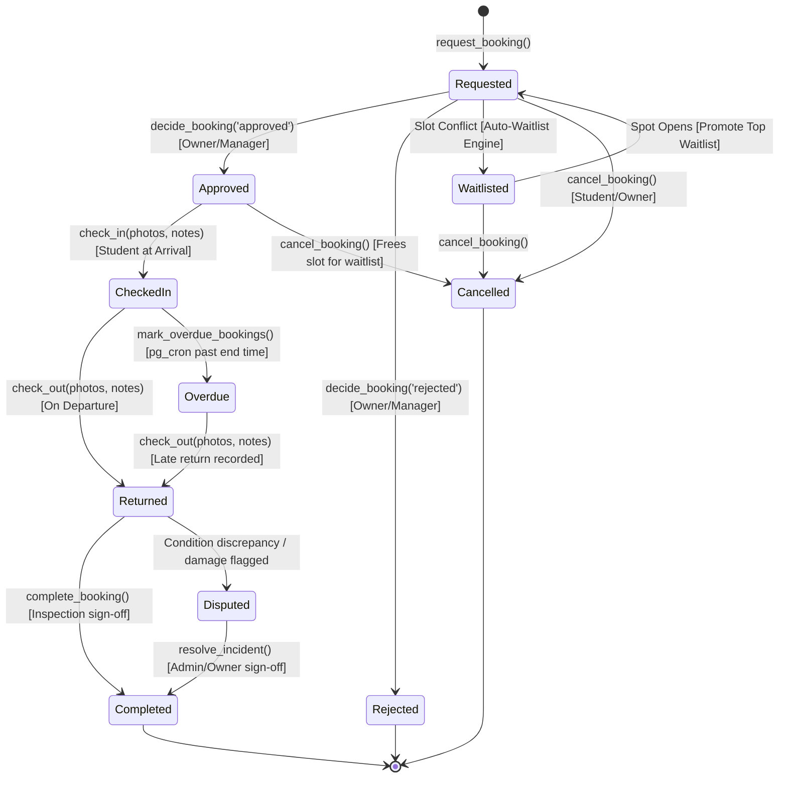

# Commons Database Architecture & State Machine

> **Source of Truth**: This document details the database architecture, schema migrations, Postgres RPC functions, Row Level Security (RLS) policies, and immutable audit ledger for **Commons**.

---

## 1. Booking Lifecycle State Machine

Status transitions on `bookings` cannot be altered directly by client applications. Every state transition executes through dedicated **Postgres RPC functions** (`SECURITY DEFINER`) that validate caller authorization, assert legal state transitions, enforce fair-use limits, update the record, and atomically append to `audit_log`.



---

## 2. Mathematical Double-Booking Prevention

Double-booking is prevented **at the database engine level**, eliminating race conditions regardless of concurrency:

```sql
ALTER TABLE bookings
  ADD CONSTRAINT no_overlapping_approved_bookings
  EXCLUDE USING gist (
    resource_id WITH =,
    time_range  WITH &&
  )
  WHERE (status IN ('approved', 'checked_in', 'overdue'));
```

- When two concurrent requests target an overlapping `time_range`, Postgres atomically locks the GiST index.
- If an approved or checked-in booking already claims the interval, the database raises an exclusion violation (`23P01`).
- The `request_booking` RPC catches this constraint error and seamlessly routes the requester into `waitlist_entries` with an automated priority calculation.

---

## 3. Fair-Use Guardrail Rules (`get_fair_use_status`)

Before any booking is submitted, the stored procedure `get_fair_use_status(p_user_id, p_resource_id)` evaluates four collegiate equity guardrails in order:

| Rule Name | Constraint Threshold | Plain English Rejection Reason |
|---|---|---|
| **No-Show Cooldown** | 48 hours following an `overdue` record | *"You have a recent unexcused no-show. Cooldown active until [timestamp]."* |
| **Weekly Category Cap** | 8.0 metered hours per resource category per week | *"Weekly limit of 8 hours reached for [category] resources this week ([hours]h used)."* |
| **Future Slot Concurrency** | Max 3 pending or approved bookings per resource | *"Maximum 3 pending/approved reservations per resource reached."* |
| **Consecutive Day Cap** | Max 2 consecutive days for scarce equipment | *"Consecutive-day limit reached. Fair-use policy preserves access for peer researchers."* |

---

## 4. Transparent Waitlist Priority Scoring

When a resource slot is conflicted, requesters are placed on the waitlist with a transparent weighted priority score (0–100):

$$\text{Priority Score} = 0.30 \times S_{\text{hours}} + 0.25 \times S_{\text{recency}} + 0.20 \times S_{\text{need}} + 0.25 \times S_{\text{reliability}}$$

Where:
- **$S_{\text{hours}}$ (Weight: 30%)**: Fewer metered hours used this month = higher priority ($\max(0, 100 - (\text{hours} \times 12.5))$).
- **$S_{\text{recency}}$ (Weight: 25%)**: Days elapsed since last successful booking ($\min(100, \text{days} \times 3.3)$).
- **$S_{\text{need}}$ (Weight: 20%)**: Academic thesis or capstone designation on file ($100$ if accredited academic need, otherwise $50$).
- **$S_{\text{reliability}}$ (Weight: 25%)**: Historical reliability ($100 - (\text{no\_shows}_{90\text{d}} \times 25)$).

The full score breakdown is saved into `waitlist_entries.score_breakdown` as JSONB so the student UI can display: *"You are #1 on the waitlist based on 4.5 hours used this month and zero historical no-shows."*

---

## 5. Append-Only Audit Trail (`audit_log`)

Every state alteration writes an immutable ledger entry. Tampering is physically prevented via triggers:

```sql
CREATE TRIGGER trg_audit_log_no_update
  BEFORE UPDATE ON audit_log
  FOR EACH ROW EXECUTE FUNCTION audit_log_no_update(); -- RAISES EXCEPTION

CREATE TRIGGER trg_audit_log_no_delete
  BEFORE DELETE ON audit_log
  FOR EACH ROW EXECUTE FUNCTION audit_log_no_delete(); -- RAISES EXCEPTION
```

Each entry records:
- `actor_id` & `actor_role`
- `action` (e.g. `booking.requested`, `booking.approved`, `booking.check_in`, `booking.returned`)
- `entity_type` & `entity_id`
- `before` & `after` JSONB snapshots
- `reason` or condition inspection notes
- `created_at` timestamp

---

## 6. Migration Registry

Migrations in `/supabase/migrations` must be executed in sequential order:

1. **`00001_initial_schema.sql`**: Enables extensions (`btree_gist`, `pgcrypto`), declares 15 enum types, creates 14 core tables with UUID primary keys and triggers, establishes storage buckets (`resource-photos`, `credentials`, `condition-photos`).
2. **`00002_rls_policies.sql`**: Configures strict Row Level Security across all 14 tables for `student`, `owner`, `manager`, and `admin`.
3. **`00003_rpc_functions.sql`**: Contains all 12 stored procedures for booking requests, decisions, photo check-in, check-out, incident escalation, and audit writing.
4. **`00004_cron_jobs.sql`**: Registers `pg_cron` recurring schedule (`*/5 * * * *`) executing `mark_overdue_bookings()`.

---

## 7. Demo Accounts & Seed Data (`seed.sql`)

The database is pre-seeded with **Eastbrook Institute of Technology** data:

| Name | Role | Email | Password | Primary Focus |
|---|---|---|---|---|
| **Aanya Patel** | Student (`user`) | `aanya@eastbrook.edu` | `demo-student-2026!` | Mechanical Eng. Senior Capstone |
| **Dr. Kavitha Rao** | Owner (`owner`) | `rao@eastbrook.edu` | `demo-owner-2026!` | Lead Custodian, Eastbrook Fab Lab |
| **Imran Syed** | Manager (`manager`) | `imran@eastbrook.edu` | `demo-manager-2026!` | ECE Department Lab Coordinator |
| **Campus Admin** | Admin (`admin`) | `admin@eastbrook.edu` | `demo-admin-2026!` | Campus Operations & Audit Review |

To seed the local database:
```bash
supabase db reset
# or apply migrations and seed manually:
psql -h localhost -U postgres -d postgres -f supabase/migrations/00001_initial_schema.sql
psql -h localhost -U postgres -d postgres -f supabase/migrations/00002_rls_policies.sql
psql -h localhost -U postgres -d postgres -f supabase/migrations/00003_rpc_functions.sql
psql -h localhost -U postgres -d postgres -f supabase/migrations/00004_cron_jobs.sql
psql -h localhost -U postgres -d postgres -f supabase/seed.sql
```

